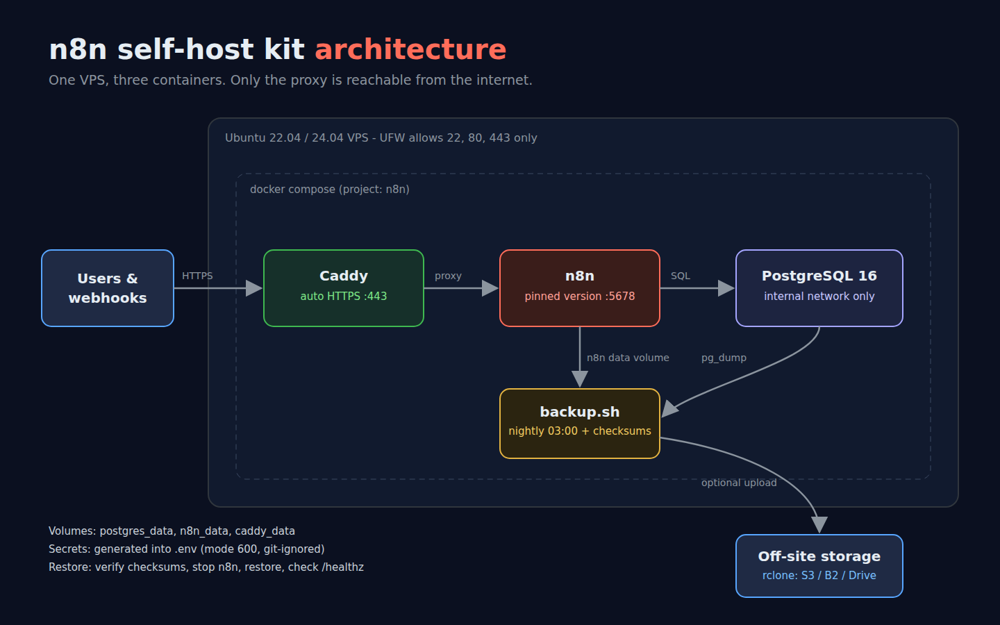
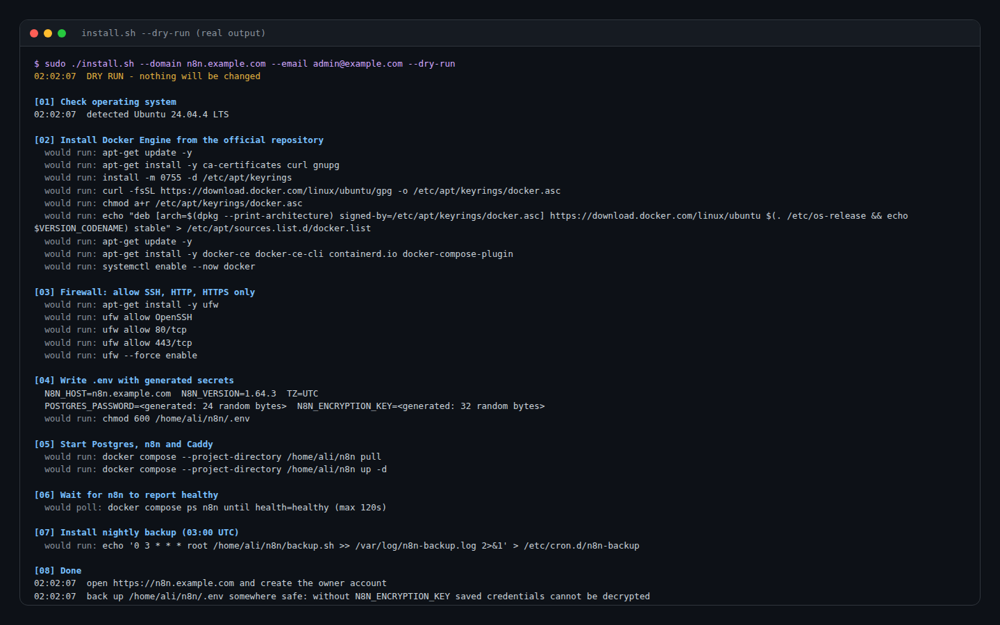
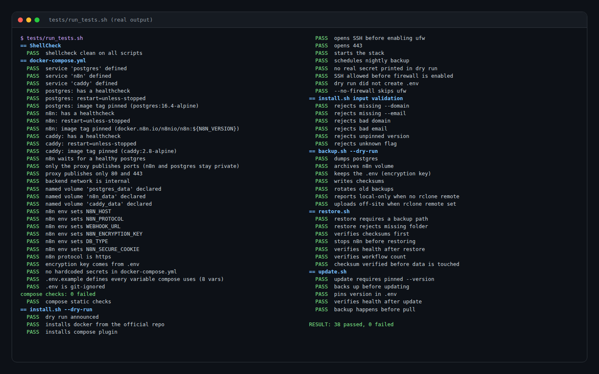

# n8n self-host kit

Run your own n8n automation server on a $5–10/month VPS: n8n + PostgreSQL behind Caddy with automatic HTTPS, a locked-down firewall, nightly backups with checksums, a verified restore, and safe version updates.




## Why self-host n8n

- No per-execution pricing — run as many workflows as your server handles.
- Your credentials and data stay on your own server.
- Webhooks get a stable HTTPS URL on your own domain.

## What this kit sets up

| Part | Details |
|---|---|
| n8n | Pinned image version, Postgres backend, secure cookies, telemetry off, execution data pruned after 14 days |
| PostgreSQL 16 | Private network only (not exposed to the internet), healthcheck, persistent volume |
| Caddy | Automatic Let's Encrypt certificates, HSTS and security headers; nginx template included as an alternative |
| Firewall | UFW allows only SSH, 80 and 443 — SSH is allowed **before** the firewall is enabled |
| Secrets | `.env` generated with random Postgres password and encryption key, file mode 600, git-ignored |
| Backups | Nightly `pg_dump` + n8n data volume + `.env`, SHA-256 checksums, rotation, optional off-site copy with rclone |
| Restore | Checksums verified before any data is touched, then health and workflow-count checks |
| Updates | Backup first, pin the new version, restart, verify health, one-line rollback |

## Quickstart

Point a DNS A record (for example `n8n.yourdomain.com`) at your server, then on a fresh Ubuntu 22.04 or 24.04 VPS:

```bash
git clone https://github.com/Ali83128/n8n-selfhost-kit.git /opt/n8n
cd /opt/n8n
sudo ./install.sh --domain n8n.yourdomain.com --email you@yourdomain.com --dry-run   # preview every step
sudo ./install.sh --domain n8n.yourdomain.com --email you@yourdomain.com
```

Open `https://n8n.yourdomain.com` and create the owner account.



| Flag | Meaning |
|---|---|
| `--domain` | Public hostname for n8n |
| `--email` | Email for Let's Encrypt notices |
| `--version` | Exact n8n version to pin (default 1.64.3; `latest` is refused on purpose) |
| `--tz` | Timezone for schedules, e.g. `Europe/London` |
| `--no-firewall` | Leave UFW alone (for servers with a provider firewall) |
| `--dry-run` | Print every command without changing anything |

## Backups and restore

```bash
sudo ./backup.sh                              # runs nightly at 03:00 UTC via /etc/cron.d/n8n-backup
sudo ./backup.sh --remote b2:my-n8n-backups   # also copy off-site with rclone
sudo ./restore.sh backups/20261010-030000     # asks you to type RESTORE before replacing data
```

Each backup folder contains `db.sql.gz`, `n8n_data.tar.gz`, `env.backup` and `SHA256SUMS`.
**Keep `env.backup` safe** — without `N8N_ENCRYPTION_KEY`, credentials saved in n8n cannot be decrypted after a restore.

## Updating n8n

```bash
sudo ./update.sh --version 1.65.0
```

It backs up first, pins the version in `.env`, pulls and restarts n8n, and checks `/healthz`. To roll back, set the old version in `.env` and run `docker compose up -d n8n`.

## Security notes

- Only Caddy publishes ports (80/443). n8n and Postgres sit on a Docker network marked `internal`.
- Images are pinned to exact versions so an update never happens by surprise.
- Turn on n8n's user management and two-factor authentication after first login.
- Restrict SSH to key-based login on the host (see my [linux-server-bootstrap](https://github.com/Ali83128/linux-server-bootstrap)).

## Using nginx instead of Caddy

`proxy/nginx-n8n.conf.template` is a ready reverse-proxy config with WebSocket support and long timeouts for n8n's editor. Remove the `caddy` service, publish n8n on `127.0.0.1:5678`, and issue a certificate with `certbot --nginx`.

## Tests

```bash
pip install shellcheck-py pyyaml
tests/run_tests.sh
```



The suite runs ShellCheck on every script, statically validates `docker-compose.yml` (services, healthchecks, pinned images, private networks, no hardcoded secrets, every variable defined in `.env.example`), and checks the `--dry-run` output of every script — including that SSH is allowed before the firewall turns on and that checksums are verified before a restore touches data. CI also runs `docker compose config` on Ubuntu 22.04 and 24.04.

**Scope of testing:** the scripts are verified with ShellCheck, dry runs and static checks in this repository. Run `--dry-run` on your own server first.

## Project structure

```
docker-compose.yml          n8n + postgres + caddy
.env.example                every setting, documented
install.sh                  first-time setup (Ubuntu 22.04/24.04)
backup.sh / restore.sh      backups with checksums, verified restore
update.sh                   backup, pin, pull, restart, verify
proxy/Caddyfile             automatic HTTPS + security headers
proxy/nginx-n8n.conf.template
scripts/lib.sh              shared helpers (dry-run, logging)
tests/                      offline test suite
```

Need n8n set up on your own server, or workflows built on it? Available on Upwork.

## License

MIT
